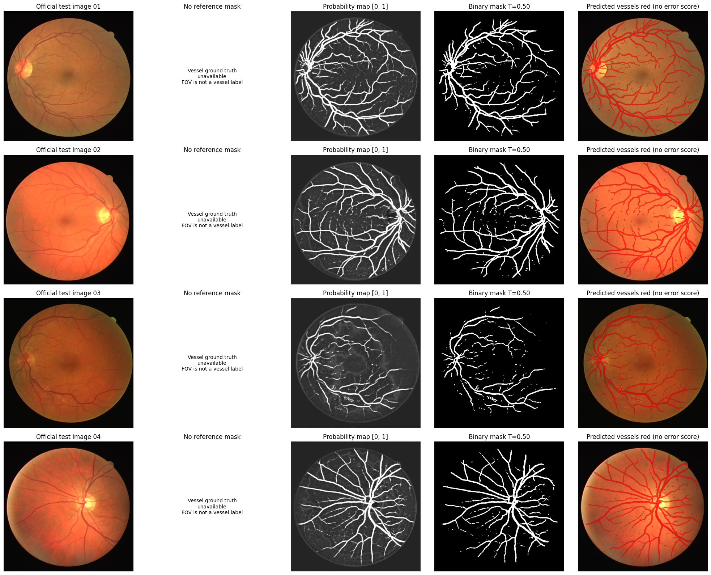

# Retinal Vessel Segmentation with U-Net

A PyTorch U-Net baseline for pixel-level retinal blood vessel segmentation on DRIVE fundus images. The latest recorded run used **16 training images, 4 validation images, and 20 official test images** and completed **15 epochs**.

The selected checkpoint achieved **validation Global Dice 0.7330** and **validation Global IoU 0.5785** at a **validation-selected threshold of 0.50**. These scores were calculated on the **four validation images**. The 20 official test images were used for prediction only: **test Dice and IoU are unavailable because authentic manual test vessel annotations were not available in this run**.

[View the executed notebook](notebook/retinal_vessel_segmentation_unet.ipynb) · [Open in Google Colab](https://colab.research.google.com/github/BensuVarol/retinal-vessel-segmentation-unet/blob/main/notebook/retinal_vessel_segmentation_unet.ipynb) · [Recorded results and provenance](results/README.md)

## Dataset and split

The notebook downloads the DRIVE dataset through KaggleHub using the handle `andrewmvd/drive-digital-retinal-images-for-vessel-extraction`. Dataset files are not bundled in this repository.

| Split | Images | Role in the recorded run | Manual vessel ground truth |
|---|---:|---|---|
| Training | 16 | Model fitting | Available |
| Validation | 4 | Checkpoint selection, threshold selection, and reported metrics | Available |
| Official test | 20 | Vessel prediction only | Unavailable in this run |
| Total | **40** | 20 official training images split into 16 + 4; 20 official test images | |

The split uses seed **42**. Validation image IDs are **25, 26, 35, and 40**; official test IDs are **01–20**. The notebook checks for overlapping image IDs and byte-identical image copies across splits. See [the recorded split IDs](results/split_ids.csv).

The files in `test/mask` are field-of-view (FOV) masks, not vessel annotations, and are not used as vessel ground truth. The notebook records that official test reference annotations are hidden. Dataset access and evaluation information: [DRIVE website](https://drive.grand-challenge.org/).

## Method

- Resize RGB fundus images to **512 × 512** with bilinear interpolation; resize manual vessel masks with nearest-neighbor interpolation.
- Normalize image values to **[0, 1]** and binarize manual vessel masks.
- Train a U-Net with encoder/decoder paths, skip connections, batch normalization, and a final 1 × 1 convolution producing one-channel logits.
- Optimize **BCEWithLogitsLoss + soft Dice loss** using **Adam**, learning rate **1e-4**, batch size **2**, for **15 epochs**.
- Select the checkpoint with the highest validation **Global Dice at fixed threshold 0.50**. In this run, the selected checkpoint is **epoch 15**.
- Search thresholds **0.10–0.85 in steps of 0.05** on the selected checkpoint's validation predictions. The selected threshold is **0.50**.
- Apply the selected checkpoint and threshold to the 20 official test images without computing test metrics.

## Recorded validation results

| Metric or setting | Value |
|---|---:|
| Validation images | **4** |
| Validation Global Dice | **0.7330** |
| Validation Global IoU | **0.5785** |
| Validation Mean image Dice | 0.7308 |
| Validation Mean image IoU | 0.5762 |
| Validation-selected threshold | **0.50** |
| Selected checkpoint epoch | **15** |
| Completed training epochs | **15** |
| Image size | 512 × 512 |
| Batch size | 2 |
| Learning rate | 1e-4 |

The saved notebook displays Global Dice **0.732961** and Global IoU **0.578483**, rounded above to four decimal places. Both the selected checkpoint and the final epoch are epoch 15 in this run.

**Global Dice** pools true-positive, false-positive, and false-negative pixels across all four validation images: `2TP / (2TP + FP + FN)`. **Global IoU** is `TP / (TP + FP + FN)`. Mean image metrics instead average the individual image scores with equal image weights.

Metrics cover **all pixels of the resized 512 × 512 images**, without FOV restriction. They are not official native-resolution DRIVE benchmark results. The same four validation images selected both the checkpoint and threshold, so these are model-selection results rather than an independent estimate of test performance.

[Validation metrics](results/validation_metrics.csv) · [Validation threshold search](results/validation_threshold_results.csv) · [15-epoch training log](results/training_log.txt) · [Recorded run summary](results/recorded_run_summary.json)

## Training curves

The following figures were extracted directly from the executed notebook's embedded PNG outputs.

### Training and validation loss


### Validation Dice and IoU

These curves use the fixed threshold of **0.50** throughout training.


## Validation predictions

All four validation images are shown in the notebook's fixed split order. Columns show the fundus image, manual vessel ground truth, probability map, binary prediction at **0.50**, and an error overlay. Red indicates false positives; blue indicates missed vessel pixels.


## Official test predictions: no Dice or IoU

The recorded run generated predictions for **all 20 official test images**. Since no authentic manual test vessel annotations were available, **test Dice, IoU, and other reference-based test metrics remain unavailable**. Empty values in [the test metric table](results/test_metrics.csv) mean unavailable, not zero.

The preview below shows the **first four fixed test IDs (01–04)**. Its red overlay marks predicted vessels; it is not an error map. No reference mask or numerical test performance is implied.



The notebook prepared native-size binary masks for all 20 test images and an optional submission ZIP in its Colab run directory. The recorded run did **not** submit the ZIP to the official evaluation server. The separate masks, ZIP, and trained checkpoint were not supplied with the notebook and are not included in this repository; the committed test artifact is the embedded preview above.

## Running the notebook

1. Open [the notebook in Google Colab](https://colab.research.google.com/github/BensuVarol/retinal-vessel-segmentation-unet/blob/main/notebook/retinal_vessel_segmentation_unet.ipynb) and select a GPU runtime for training.
2. Run cells from top to bottom. The first cell installs missing dependencies while retaining Colab's existing PyTorch/CUDA installation.
3. Keep the default test-label options empty unless you have authentic manual test vessel annotations and their source/access information. FOV masks cannot replace vessel annotations.
4. With no compatible saved checkpoint, the notebook trains for 15 epochs. A compatible checkpoint from a prior run can be reused if available.
5. Inspect the validation results and prediction figures, then save required run artifacts before ending the temporary Colab session. Optional Drive backup and ZIP download are controlled by settings in the notebook.

For a local environment, install [requirements.txt](requirements.txt) before opening the notebook. Training time and exact numerical results may depend on the runtime and library versions.

The repository notebook is a byte-for-byte copy of the supplied, fully executed `Retinal_Vessel_Segmentation_UNet_.ipynb`. Its 19 code cells have execution counts and no recorded error outputs. The repository update did not rerun training or inference. Links printed under `/content/...` belong to the original temporary Colab session; use the repository links above for committed artifacts. `SOURCE_NOTEBOOK` inside the notebook records the earlier baseline's provenance.

## Limitations

- Only **four validation images** support the reported metrics; checkpoint and threshold selection share that set.
- **No independent test Dice/IoU** is available from this run.
- Resizing to 512 × 512 and evaluating the full image differs from the official native-resolution/FOV evaluation scope.
- The baseline can miss thin vessel segments and produce false positives, as shown in the validation error overlays.
- No advanced vessel-specific preprocessing, data augmentation, or post-processing was used in this run.

## Repository structure

```text
retinal-vessel-segmentation-unet/
├── notebook/
│   └── retinal_vessel_segmentation_unet.ipynb
├── results/
│   ├── README.md
│   ├── input_pairs.png
│   ├── training_validation_loss.png
│   ├── validation_dice_iou.png
│   ├── sample_predictions/
│   │   └── sample_predictions.png
│   ├── test_predictions.png
│   ├── training_log.txt
│   ├── validation_metrics.csv
│   ├── validation_threshold_results.csv
│   ├── test_metrics.csv
│   ├── split_ids.csv
│   └── recorded_run_summary.json
├── README.md
├── requirements.txt
└── .gitignore
```

## Technologies

Python, PyTorch, NumPy, pandas, Matplotlib, Pillow, IPython, KaggleHub, and Google Colab.

## Author

Bensu Varol

MSc Computer Engineering Student

Interested in medical image analysis, deep learning, computer vision, explainable AI, and healthcare AI.
