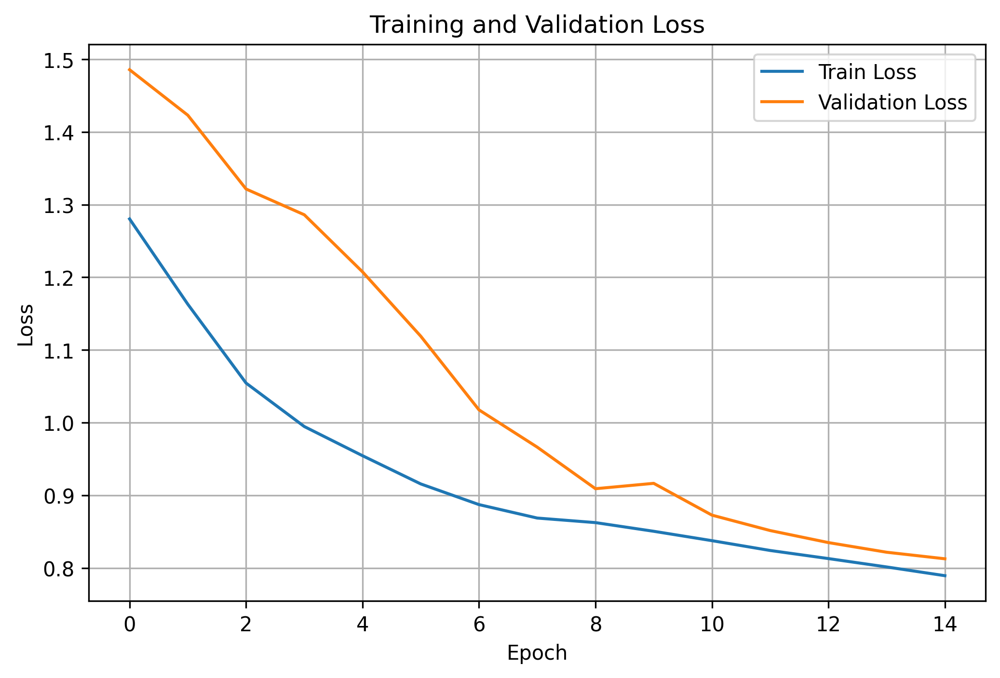
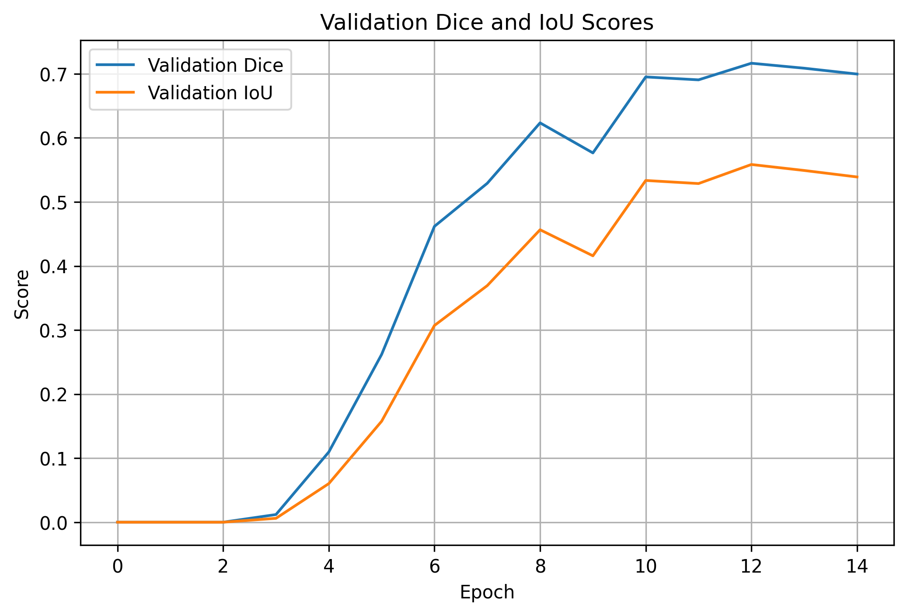
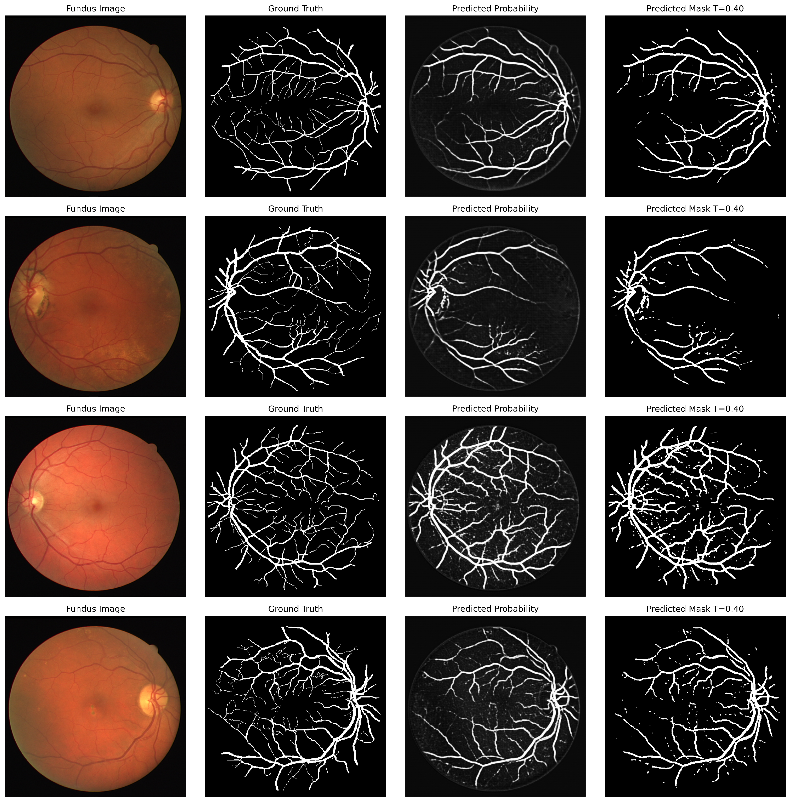

# Retinal Vessel Segmentation with U-Net

This project implements a U-Net based deep learning model for retinal blood vessel segmentation from fundus images. The goal is to perform pixel-level segmentation of retinal vessels, which is an important task in medical image analysis and computer-aided ophthalmic diagnosis.

## Project Overview

Retinal blood vessel segmentation is important for analyzing retinal fundus images and supporting the diagnosis of ophthalmic and vascular diseases. In this project, a baseline U-Net model was trained to segment retinal vessels using fundus images and manually annotated vessel masks.

The project demonstrates the use of deep learning for biomedical image segmentation, including image preprocessing, model training, evaluation with segmentation metrics, and visualization of predicted vessel masks.

## Dataset

The project uses the DRIVE dataset for retinal vessel segmentation.

The dataset contains retinal fundus images and corresponding manually annotated blood vessel masks. The training subset was used to train and validate the U-Net model.

The dataset is downloaded directly in the notebook using `kagglehub`, so the dataset files are not included in this repository.

## Methodology

The workflow includes:

- Loading retinal fundus images and manual vessel masks
- Resizing images and masks to 512 × 512 pixels
- Normalizing images to the range [0, 1]
- Binarizing vessel masks
- Training a U-Net model for binary segmentation
- Evaluating the model using Dice score and IoU
- Selecting the best prediction threshold
- Visualizing predicted probability maps and binary vessel masks

## Model Architecture

The model is based on the U-Net architecture, which consists of:

- Encoder path for feature extraction
- Bottleneck layer for deep feature representation
- Decoder path for spatial reconstruction
- Skip connections between encoder and decoder layers
- Final 1 × 1 convolution for binary vessel segmentation

The model outputs a single-channel segmentation map representing the probability of each pixel belonging to a blood vessel.

## Loss Function

A combined BCE and Dice loss was used:

- Binary Cross Entropy Loss
- Dice Loss

This combination helps the model learn both pixel-level classification and overlap-based segmentation quality.

## Results

The baseline U-Net model was trained for 15 epochs.

| Metric | Value |
|---|---:|
| Best Validation Dice | 0.7027 |
| Final Validation Dice | 0.6997 |
| Final Validation IoU | 0.5390 |
| Best Threshold | 0.40 |
| Image Size | 512 × 512 |
| Epochs | 15 |
| Batch Size | 2 |
| Learning Rate | 1e-4 |

The best validation Dice score was achieved using a threshold of 0.40.

## Training Curves

### Training and Validation Loss



### Validation Dice and IoU



## Sample Predictions

The model successfully detects major retinal vessel structures. However, some thin vessels are missed, and small false positive regions may appear in the predicted masks.



## Limitations

This project represents a baseline U-Net implementation. Some limitations include:

- The dataset size is small
- The validation set contains only a few images
- Thin vessels are harder to detect accurately
- Some false positive noise appears in the predicted masks
- No advanced preprocessing or post-processing was applied

## Technologies Used

- Python
- PyTorch
- NumPy
- Matplotlib
- PIL
- Google Colab
- KaggleHub

## Repository Structure

```text
retinal-vessel-segmentation-unet/
│
├── notebook/
│   └── retinal_vessel_segmentation_unet.ipynb
│
├── results/
│   ├── training_validation_loss.png
│   ├── validation_dice_iou.png
│   └── sample_predictions/
│       └── sample_predictions.png
│
├── README.md
├── requirements.txt
└── .gitignore
```
